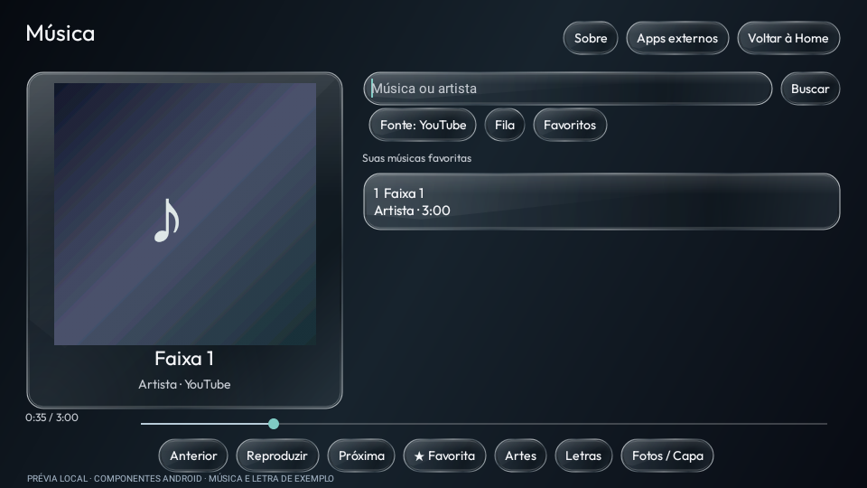
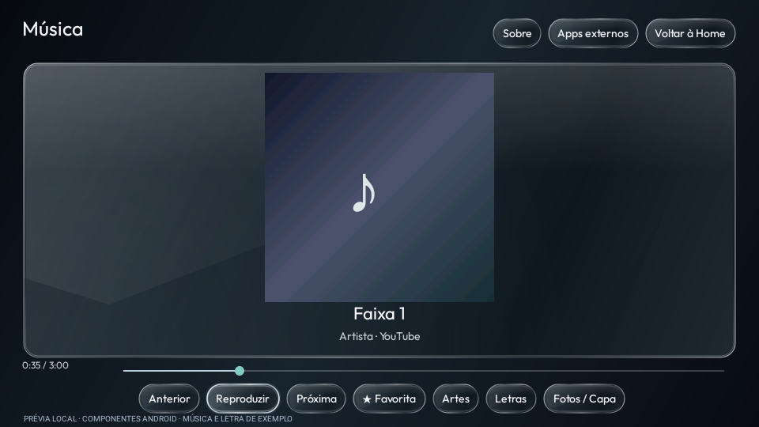
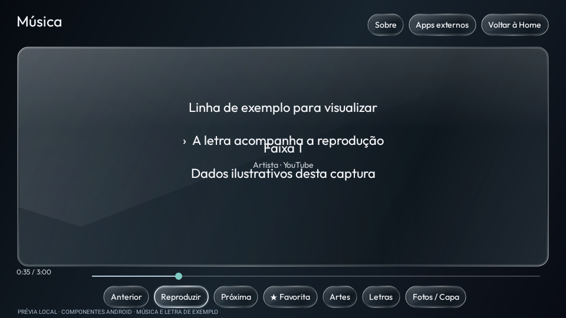

# Launcherin preview19 — player integrado (teste)

[Baixar APK da TV](../../Downloads/Launcherin-TV-0.1.0-preview19.apk) · [Como instalar e usar](../../Validacao/preview19/LEIA-ME.md) · [Resultados e limites dos testes](../../Validacao/preview19/RESULTADOS.md)

Pesquise músicas do YouTube/SoundCloud, monte uma fila, salve favoritos, controle o áudio, abra artes/fotos e consulte letras dentro da Launcherin. Segure OK em um controle do widget Continuar ouvindo para abrir a biblioteca. O ícone de TV aberta também foi corrigido.

**É uma versão experimental:** SoundCloud e letras responderam nos testes de rede; o acesso ao YouTube foi bloqueado pelo ambiente. Reprodução, fluidez e temporizadores ainda exigem validação na TCL física. O celular permanece na preview18 e seu APK de TV embutido não é esta versão.

| Biblioteca | Artes | Letras |
|---|---|---|
|  |  |  |

Capturas de componentes reais do Android em execução local, com dados de exemplo; não são capturas da TCL nem de reprodução real.

[Fontes do player](../../Projetos/Launcherin/launcher/app/src/main/java/app/launcherin/tv/LauncherinPlayerService.java) · [Licenças](../../Projetos/Launcherin/launcher/PLAYER-LICENSE.md) · [Checksums](../../Validacao/preview19/SHA256SUMS.txt)
