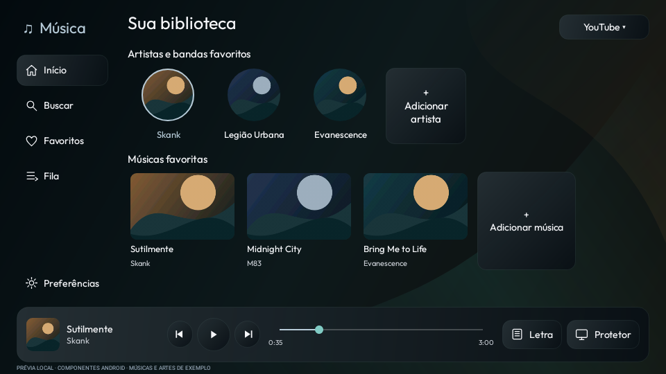
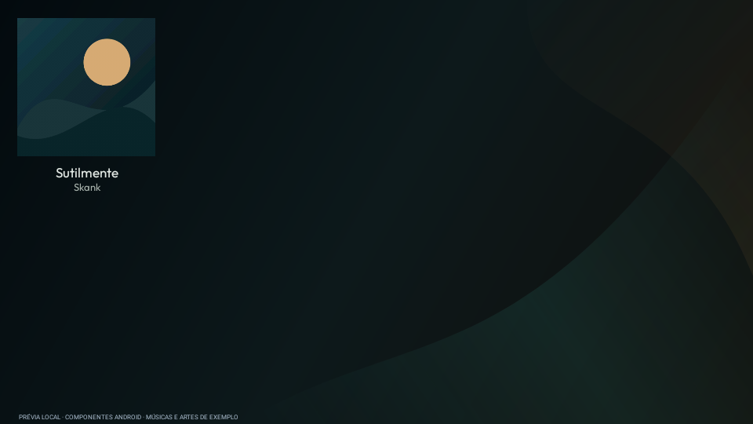
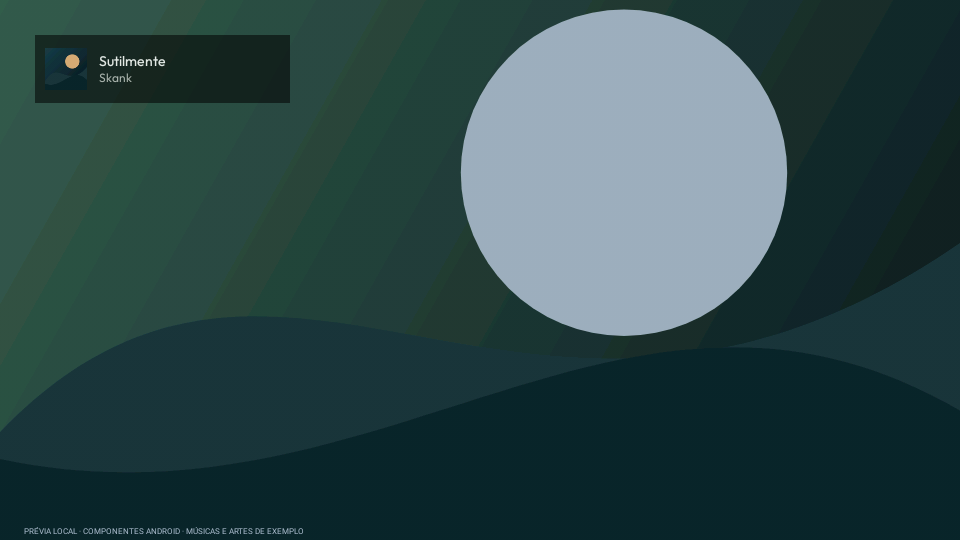
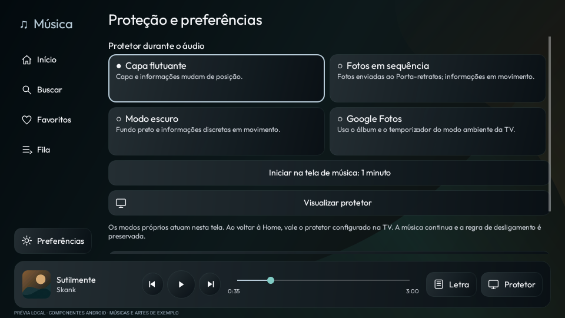

# Launcherin preview20 — biblioteca de música e proteção durante o áudio

[Baixar APK da TV](../../Downloads/Launcherin-TV-0.1.0-preview20.apk) · [Instalação e uso](../../Validacao/preview20/LEIA-ME.md) · [Testes e limites](../../Validacao/preview20/RESULTADOS.md)

Biblioteca reorganizada com menu lateral, artistas e bandas favoritos, ações claras
para as músicas e uma única barra de reprodução. O serviço de áudio da preview19
foi preservado. O celular permanece na versão atual; instale o APK diretamente na TV.

## Proteção durante o áudio

| Capa flutuante | Fotos em sequência | Modo escuro |
|---|---|---|
|  |  |  |

Google Fotos também é uma opção em **Preferências**: usa o álbum e o temporizador
do modo ambiente da TCL. No Android 14, não promete início imediato pelo antigo
atalho de protetor. O botão de configurar abre a seleção nativa do sistema.

[Busca](../../Midia/preview20/music-search.png) · [Fila](../../Midia/preview20/music-queue.png)

Estas são capturas locais de componentes reais do Android, com músicas e artes de
exemplo. Não representam a TCL física nem seu álbum privado. O comportamento do
Google Fotos, o controle físico, a RAM e a fluidez ainda precisam de teste na TV.

[Licenças e código correspondente](../../Projetos/Launcherin/launcher/PLAYER-LICENSE.md) · [SHA256](../../Validacao/preview20/SHA256SUMS.txt)
