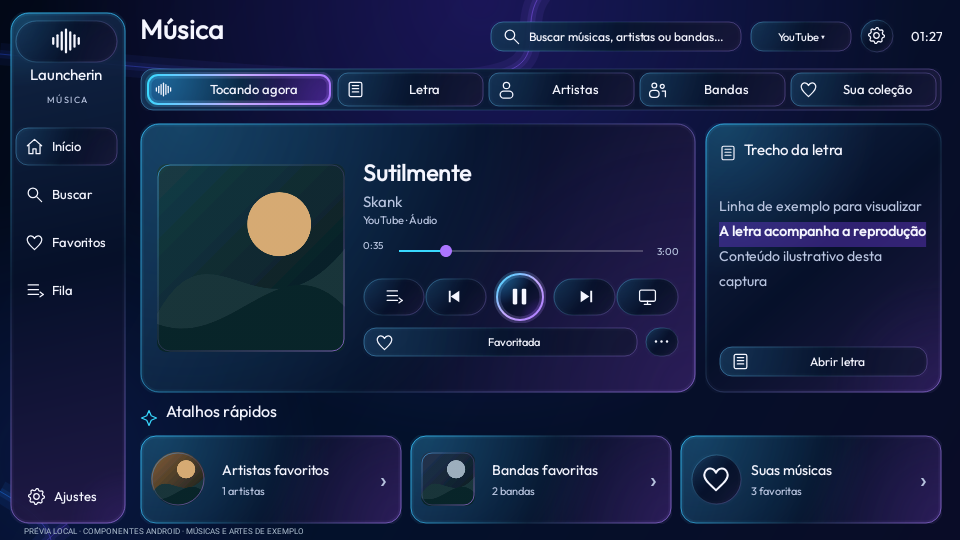
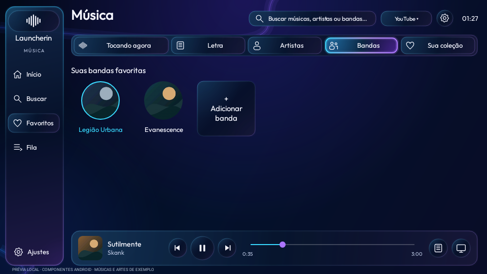

# Launcherin Música — preview21 de teste

Player central com capa, vidro azul profundo e bordas ciano/violeta, trecho da letra
sincronizada ao lado, abas de artistas e bandas e atalhos de favoritos. A nova aparência
fica na tela de música: a Home, os widgets e os atalhos continuam preservados.

- [Baixar APK da TV preview21](../../Downloads/Launcherin-TV-0.1.0-preview21.apk?raw=true)
- [Instalação e uso](../../Validacao/preview21/LEIA-ME.md)
- [Testes e limites](../../Validacao/preview21/RESULTADOS.md)
- [Hashes](../../Validacao/preview21/SHA256SUMS.txt)
- [Código do player](../../Projetos/Launcherin/launcher/app/src/main/java/app/launcherin/tv/LauncherinPlayerActivity.java)
- [Licenças](../../Validacao/preview21/PLAYER-LICENSE.md)

Instale **somente este APK na TV**, por cima da instalação existente, sem apagar dados.
O celular segue preview18 nesta entrega. Seu botão de atualizar a TV contém a versão
antiga; use o APK acima para esta candidata. O pacote e o certificado são preservados.

Na Home, segure OK sobre Play do widget Continuar ouvindo, ou selecione o seu título.
Abra Ajustes na tela de música para configurar a proteção, incluindo Google Fotos
pelo modo ambiente da TV. Favoritos antigos sem categoria ficam em Artistas e podem
ser movidos para Bandas nas opções. Fila, progresso e demais favoritos são preservados.

## Capturas da interface Android

Estas imagens usam dados e artes de exemplo, em renderização local Robolectric API35.
Não são capturas da TCL nem evidência de áudio em reprodução no aparelho real.

[Artistas](../../Midia/preview21/music-artists.png) ·
[Busca](../../Midia/preview21/music-search.png) ·
[Fila](../../Midia/preview21/music-queue.png) ·
[Letra ampliada](../../Midia/preview21/music-lyrics.png) ·
[Protetores](../../Midia/preview21/music-protection-settings.png) ·
[Capa flutuante](../../Midia/preview21/music-saver-cover.png) ·
[Modo escuro](../../Midia/preview21/music-saver-dark.png) ·
[Fotos em sequência](../../Midia/preview21/music-saver-photos.png)

A variante TV com NewPipe Extractor é GPL-3.0-ou-posterior. O código correspondente
fica neste mesmo commit. Não há perfis fictícios nem indicadores FLAC/Dolby/Lossless
sem suporte; a interface mostra a fonte real da música e as coleções salvas.

Compilação e testes locais estão registrados na validação. Instalação, fluidez,
RAM/GPU, teclas físicas, música ao vivo e álbum Google Fotos ainda exigem teste na TCL.
