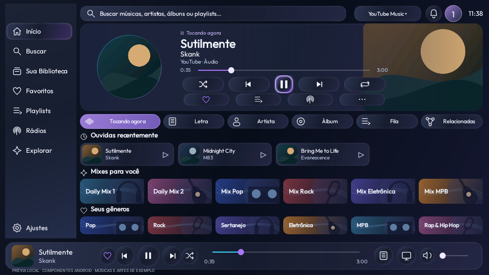
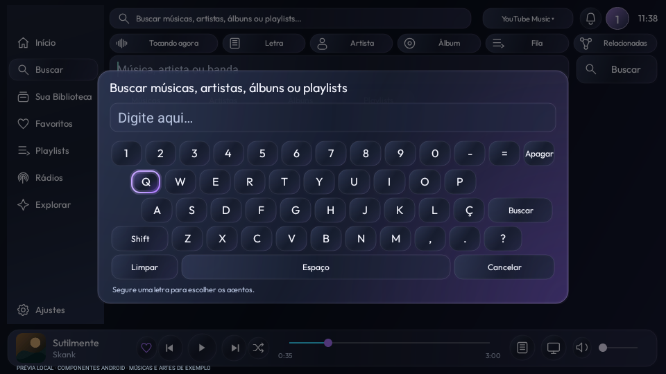
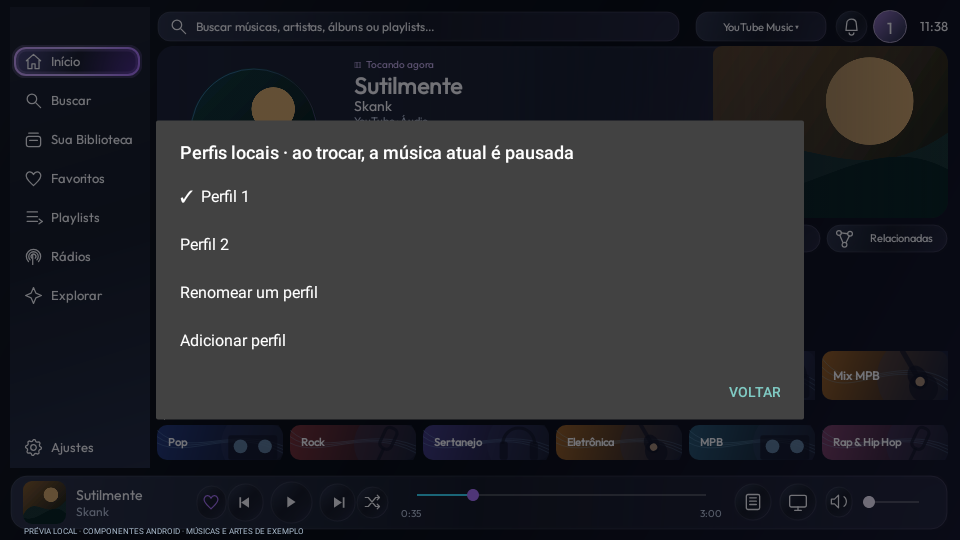
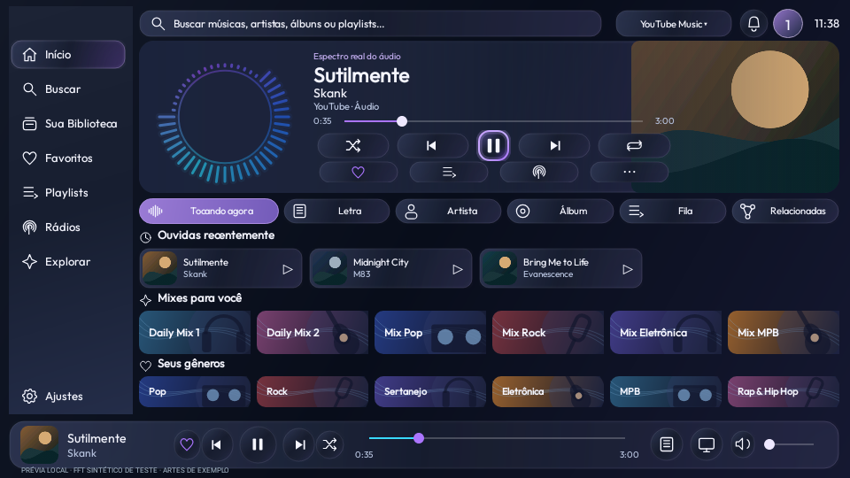

# Launcherin Música — preview22 de teste

Nova composição da música, sem a marca superior esquerda, com teclado PC QWERTY,
acentos ao segurar a letra, dois perfis locais, fotos de artistas, histórico,
playlists e visualizador circular opcional. Home e seus componentes preservados.

- [Baixar APK da TV preview22](../../Downloads/Launcherin-TV-0.1.0-preview22.apk?raw=true)
- [Baixar APK Mobile preview22](../../Downloads/Launcherin-Mobile-0.1.0-preview22.apk?raw=true)
- [Instalação, uso e limites](../../Validacao/preview22/LEIA-ME.md)
- [Testes](../../Validacao/preview22/RESULTADOS.md)
- [Hashes e assinatura](../../Validacao/preview22/SHA256SUMS.txt)
- [Licenças](../../Validacao/preview22/PLAYER-LICENSE.md)

Instale os APKs diretamente, por cima das instalações existentes, sem apagar dados.
**O instalador embutido no Mobile ainda contém a TV18:** ele não instala esta nova
TV22. O limite de8 MiB do celular foi mantido. Depois de instalar TV22 e Mobile22,
as novas opções ficam em **Widgets → Visualizador e proteção musical** no celular.
Na TV, abra Música → Ajustes para habilitar e permitir a análise do áudio.

O botão de perfil do cabeçalho permite renomear Perfil1/Perfil2. São bibliotecas
locais da Launcherin, não contas dos serviços. O perfil inicial mantém os dados
anteriores; trocar pausa e salva a música do perfil atual.

## Capturas da interface Android

Dados e artes de exemplo, renderizados em testes locais. Não são capturas da TCL.

[Artistas](../../Midia/preview22/music-artists.png) ·
[Bandas](../../Midia/preview22/music-bands.png) ·
[Busca](../../Midia/preview22/music-search.png) ·
[Letra](../../Midia/preview22/music-lyrics.png) ·
[Fila](../../Midia/preview22/music-queue.png) ·
[Ajustes e proteção](../../Midia/preview22/music-protection-settings.png)

### Visualizador: dados sintéticos de teste

Estas imagens demonstram a interface com FFT conhecido injetado pela fixture.
**Não comprovam captura real na TCL.** A implementação usa a API Visualizer da
sessão própria; exige permissão de áudio e suporte do firmware. Sem acesso,
há ambiente opcional sem batidas simuladas.

A proteção inteligente pode ser desligada para usar os modos anteriores, incluindo
Google Fotos com seu álbum/temporizador nativos. Tela preta não desliga fisicamente
um painel LED. Consumo real, áudio, entrada nos protetores e atualização sobre a
instalação anterior ainda precisam de teste na TV física.

Código da TV e do celular neste mesmo commit, em Projetos/Launcherin e
Projetos/Launcherin-Mobile. Nenhuma chave privada, configuração pessoal ou cache
musical está incluído. TV com NewPipe: GPL-3.0-ou-posterior; avisos MIT preservados.
