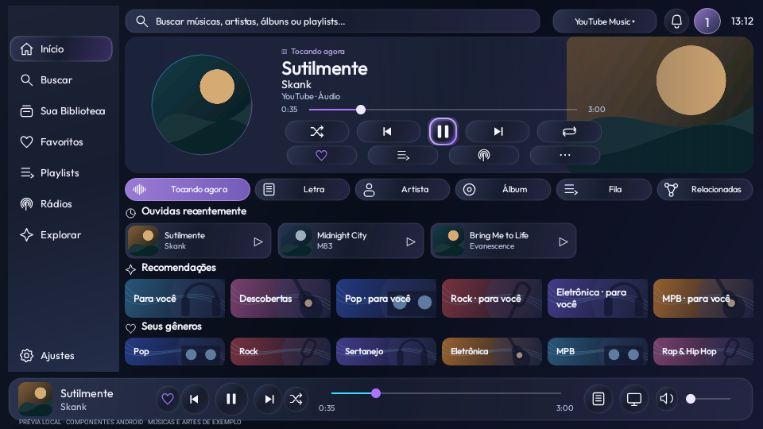
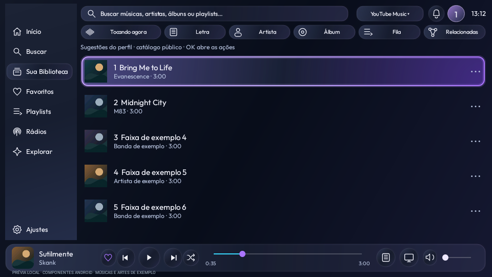

# Launcherin Música — preview23 de teste

A seção **Recomendações** aprende com a escuta no player da Launcherin, separadamente por perfil. Gostei e Não recomendar estão nas ações da faixa/⋯. O aprendizado pode ser revisto e zerado sem apagar a biblioteca.

[Baixar APK da TV preview23](../../Downloads/Launcherin-TV-0.1.0-preview23.apk?raw=true)

Atualize somente a TV. O Mobile preview22 continua compatível e não precisa ser atualizado nesta entrega. Instale por cima, sem desinstalar. O instalador TV embutido no Mobile22 contém uma versão anterior e não instala esta atualização.

[Instalação, uso e limites](../../Validacao/preview23/LEIA-ME.md) · [Resultados dos testes](../../Validacao/preview23/RESULTADOS.md) · [Integridade](../../Validacao/preview23/SHA256SUMS.txt) · [Licenças](../../Validacao/preview23/PLAYER-LICENSE.md)

591 testes automatizados da TV passaram, sem erros de lint, e assinatura igual à versão anterior. Teste físico de atualização, fluidez e qualidade de sugestões na TCL P7K pendente. As sugestões vêm do catálogo público, não de uma conta autenticada do serviço.

## Tela principal

## Lista de recomendações

## Aprendizado por perfil

Esta é uma versão de teste em branch própria, sem merge na main nem release de produção. O código correspondente está em Projetos/Launcherin nesta mesma revisão.
