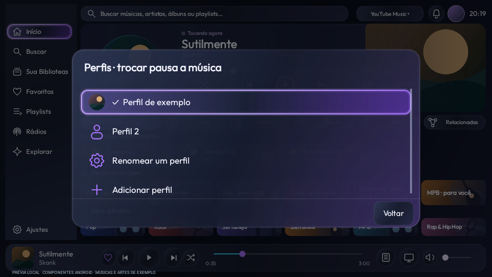
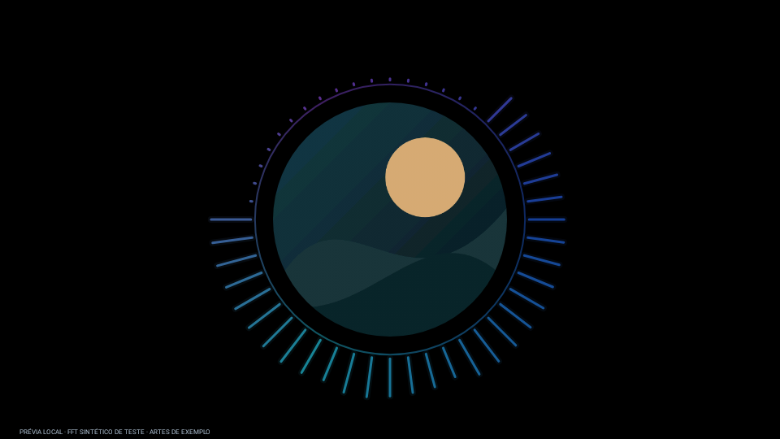
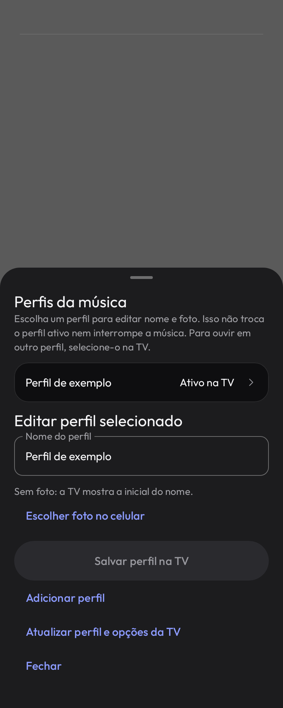

# Launcherin — preview24 de teste

Menus internos de música e Home com acabamento das telas, foto de perfil configurada pelo celular e visualizador circular em tela cheia. Reprodução, letras, recomendações por perfil, widgets e organização da Home preservados.

**Atualize os dois aplicativos por cima, sem desinstalar:**

- [Baixar APK Launcherin TV preview24](../../Downloads/Launcherin-TV-0.1.0-preview24.apk?raw=true)
- [Baixar APK Launcherin Mobile preview24](../../Downloads/Launcherin-Mobile-0.1.0-preview24.apk?raw=true)

No celular: **Personalizar → Perfis da música → Escolher foto no celular → Salvar perfil na TV**. Editar não troca o perfil ativo nem interrompe a reprodução.

Na música da TV: selecione a **capa circular** e pressione OK, ou use **⋯ → Visualizador em tela cheia**. Voltar restaura o player sem pausar.

O instalador embutido de tela inicial do Mobile ainda contém a TV18 e não instala esta versão. Instale o APK TV24 acima diretamente.

[Instruções completas](../../Validacao/preview24/LEIA-ME.md) · [Resultados](../../Validacao/preview24/RESULTADOS.md) · [Hashes](../../Validacao/preview24/SHA256SUMS.txt) · [Licenças](../../Validacao/preview24/PLAYER-LICENSE.md)

1.458 testes passaram e lint sem erros. Mesma assinatura anterior. TCL física e medições de desempenho pendentes.

## Menu e foto de perfil

## Visualizador em tela cheia

## Configuração no celular

As capturas mostram os componentes Android, não uma TCL conectada. As artes e músicas são de exemplo; as frequências do exemplo visual são sintéticas e não constituem prova de captura real do áudio. Os códigos correspondentes estão em Projetos/Launcherin e Projetos/Launcherin-Mobile nesta mesma revisão. Sem merge da main ou release de produção.
