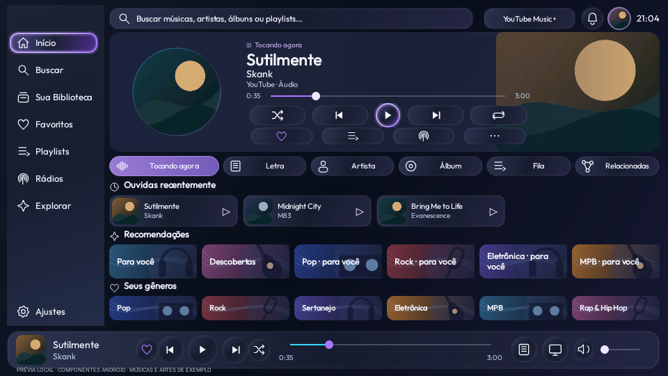

# Launcherin TV preview25 — foto e capas

Correção da foto do perfil na bolinha superior e da seleção/carregamento de miniaturas maiores na música.

[**Baixar APK da TV preview25**](../../Downloads/Launcherin-TV-0.1.0-preview25.apk?raw=true)

Atualize somente a TV, por cima, sem desinstalar. Mantenha o Mobile preview24. As fotos já salvas não precisam ser apagadas ou recadastradas.

As capas usam a maior versão compatível disponibilizada pelas fontes conhecidas e deixam de reaproveitar o cache pequeno antigo. Se a fonte não oferece versão maior, retorna à original. Cache e processamento continuam limitados.

[Uso e limites](../../Validacao/preview25/LEIA-ME.md) · [Testes](../../Validacao/preview25/RESULTADOS.md) · [Integridade](../../Validacao/preview25/SHA256SUMS.txt) · [Licenças](../../Validacao/preview25/PLAYER-LICENSE.md)

634 testes passaram, lint sem erros, mesma assinatura. Teste físico de qualidade e fluidez na TCL pendente.

