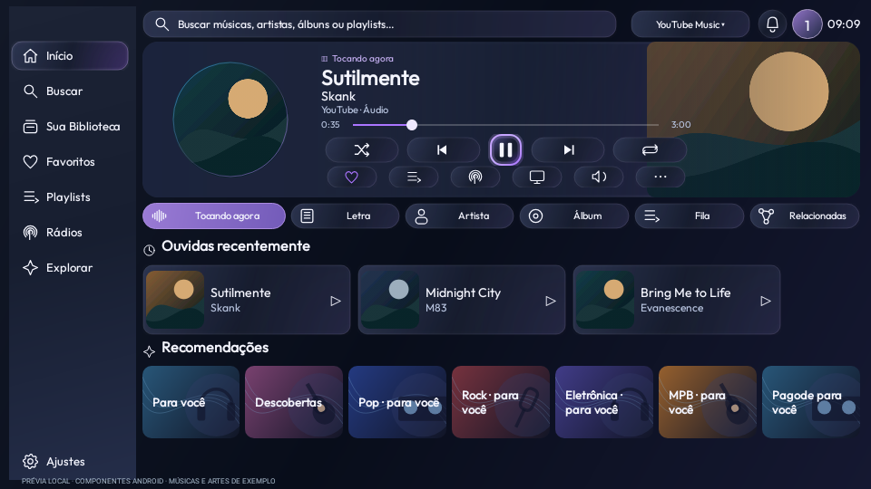
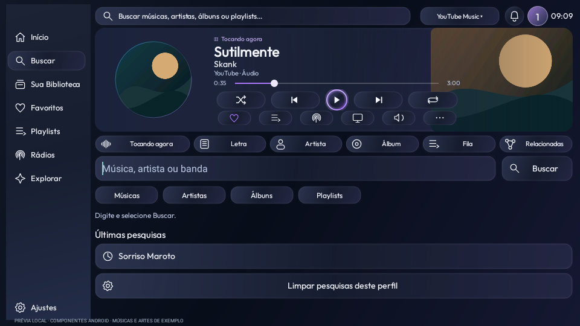
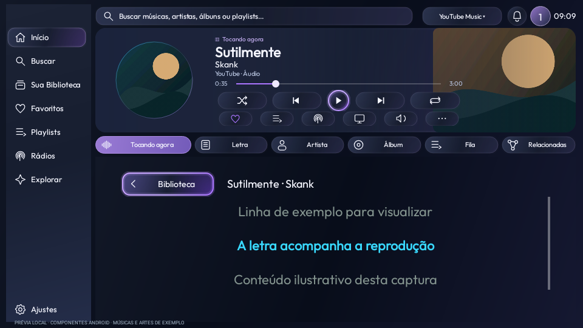

# Launcherin TV preview26 — player fixo e últimas pesquisas

[**Baixar APK da TV preview26**](../../Downloads/Launcherin-TV-0.1.0-preview26.apk?raw=true)

Atualize somente a TV, por cima da instalação atual, sem desinstalar. Mantenha o Mobile preview24.

Player superior fixo durante a navegação, sem mini-player inferior nem linha “Seus gêneros”. Cartões maiores em Ouvidas recentemente e Recomendações, incluindo “Pagode para você”. Buscar mostra até12 pesquisas por perfil; OK repete e manter OK remove.

[Como usar](../../Validacao/preview26/LEIA-ME.md) · [Testes e limites](../../Validacao/preview26/RESULTADOS.md) · [Integridade](../../Validacao/preview26/SHA256SUMS.txt) · [Licenças](../../Validacao/preview26/PLAYER-LICENSE.md)

646 testes locais passaram e lint não registrou erros. Mesma assinatura. Validação física na TCL e métricas de desempenho pendentes.

As imagens seguintes são renderizações dos componentes Android com músicas e artes de exemplo.

