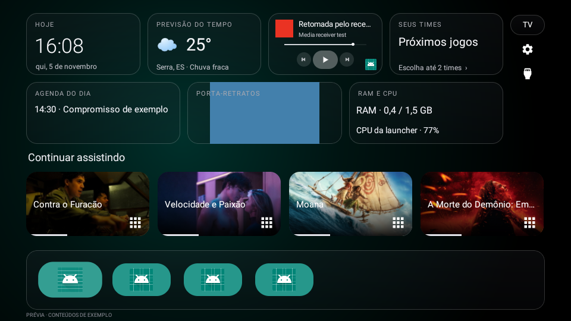
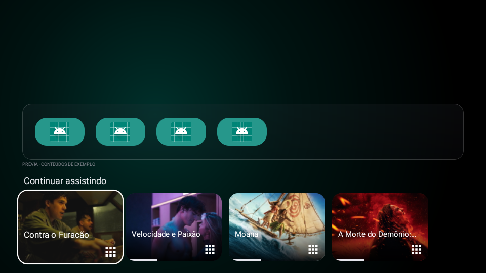

> Os APKs desta candidata estão em [Downloads](Downloads/README.md). A versão publicada anteriormente em Releases continua sendo preview10. O ZIP de compartilhamento antigo permanece como arquivo histórico; os fontes atualizados estão nesta ramificação.

# Launcherin

Launcher para Android TV/Google TV com aplicativo de configuração para celular Android, em português brasileiro. Fork independente de [CleanYourTV](https://github.com/Gathin23/cleanyourtv) e [Clean Your TV App](https://github.com/udhaykumarbala/cleanyourtv-app).

**Candidata de teste: 0.1.0-preview12.** Corrige o encaminhamento da tecla de configurações para o painel lateral nativo das TCL compatíveis e inclui a proteção do desligamento durante música da preview11. [Instalação e teste](Guias/PAINEL-TCL-preview12.md). A chamada nativa foi confirmada na TV via ADB; o botão físico com o APK novo e a proteção de standby ainda precisam de teste após instalar a TV20. Este é um fork independente, não uma versão oficial do CleanYourTV.

## Downloads

Os links dos APKs e ZIPs ficam em [Releases](https://github.com/allanlribeiro/laucherin/releases) e na [pasta Downloads](Downloads/README.md). Para instalar, use os APKs preview12; para preparar o tutorial com a Clara, use o ZIP principal menor. A cópia completa do repositório também preserva as imagens históricas e as comparações automáticas dos testes.

| Aplicativo | Identificador | Código | Android mínimo |
| --- | --- | --- | --- |
| Launcherin TV | app.launcherin.tv | 19 | Android8/API26 |
| Launcherin Mobile | app.launcherin.mobile | 11 | Android9/API28 |

Atualize sobre as instalações existentes, sem desinstalar nem apagar os dados. O APK do celular inclui exatamente o mesmo APK da TV, mas instalar na TV exige conexão e autorização: não acontece apenas ao abrir o app no celular.

## Guias em português

- [Instalação e configuração](Guias/INSTALACAO-E-CONFIGURACAO.md)
- [Roteiro e briefing para Clara criar o tutorial](Guias/ROTEIRO-PARA-CLARA.md)
- [Compilação e assinatura](Guias/COMPILACAO.md)
- [Visão geral do pacote de compartilhamento](LEIA-ME-PRIMEIRO.md)

Alguns guias descrevem a estrutura do ZIP, no qual os APKs estão em Distribuicao/APKs. No GitHub, baixe os instaladores pela página Releases. As instruções de sistema podem variar conforme o firmware da TV.

## Recursos

- Widgets de relógio, tempo, música, esportes, Agenda do dia, Porta-retratos e RAM/CPU.
- Escolha de visibilidade, tamanho e posição dos widgets pelo celular.
- Agenda cadastrada na Launcherin, enviada separadamente sem refazer a configuração ou reiniciar a TV a cada compromisso.
- Continuar assistindo acima dos apps, abaixo dos apps ou oculto. No modo abaixo, ↓ revela os conteúdos mantendo os apps visíveis; ↑ ou Voltar recolhe.
- Até dois times favoritos, controles de transparência, papel de parede e decoração de Natal.
- Integração com TV ao vivo, entradas e controles de mídia conforme permissões e suporte do aparelho.

## Capturas

As imagens abaixo foram produzidas em emulador/renderização de teste, com dados e apps de exemplo. Não são fotografias da TCL nem confirmação de integração com os serviços oficiais.

[Organizar widgets no celular](Midia/Capturas/Preview10/celular-organizar-widgets.png) · [Agenda no celular](Midia/Capturas/Preview10/celular-agenda.png)

## Estrutura do código

- [Projetos/Launcherin](Projetos/Launcherin): projeto da TV; o módulo Android fica em launcher/.
- [Projetos/Launcherin-Mobile](Projetos/Launcherin-Mobile): aplicativo Android e conteúdo do submódulo de terceiros.
- [Midia](Midia): capturas atuais/históricas e papel de parede.
- [Validacao](Validacao): resultados e hashes dos APKs preview10.
- [Distribuicao/Scripts](Distribuicao/Scripts): scripts opcionais documentados para permissões de temporizadores e diagnóstico.

O histórico LAUNCHERIN.md de cada projeto registra as adaptações. Os READMEs e arquivos de CI dos projetos de origem foram preservados e podem citar outros nomes, versões e certificados. Priorize os guias deste repositório para esta distribuição.

## Validação e limites desta versão

165 testes JUnit e5 verificações Android de widgets/navegação passaram. Lint dos módulos verificados não registrou erros. A assinatura e a identidade do APK TV incluído no celular foram conferidas; detalhes em [validation-preview10.json](Validacao/validation-preview10.json).

Ainda falta validar esta atualização na TCL física. A retomada de Spotify/YouTube Music após fechar os apps e a entrada automática no protetor Google Fotos permanecem pendentes de teste físico. O álbum é escolhido no Google TV/Google Home, sem acesso à biblioteca privada pelo companion.

O auxiliar Home mantém o Google TV ativo e pode deixar a Home original aparecer brevemente antes de redirecionar, conforme o firmware. Este projeto não garante eliminar esse efeito em todos os aparelhos.

## Créditos e licenças

As licenças MIT e os avisos dos projetos de origem foram preservados:

- [Licença do projeto da TV](Projetos/Launcherin/LICENSE)
- [Licença do projeto do celular](Projetos/Launcherin-Mobile/LICENSE)
- [Avisos de terceiros do aplicativo](Projetos/Launcherin-Mobile/THIRD-PARTY-NOTICES)

Chaves privadas de assinatura/ADB, credenciais, backups pessoais, caches, configurações locais e saídas de compilação não estão incluídos. Os APKs assinados estão disponíveis separadamente em Releases; uma compilação própria exige sua própria configuração de assinatura e não substitui automaticamente os APKs existentes por cima.
